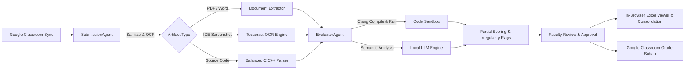

# 🎓 Assignment Evaluator

[](https://www.python.org/downloads/)
[](https://fastapi.tiangolo.com)
[](https://tailwindcss.com)
[](https://developers.google.com/classroom)
[](https://www.sqlite.org/)
[]()
[]()

> **Intelligent, Faculty-Controlled Assignment Evaluation & Grade Management Platform Powered by Local LLMs, OCR, and Code Sandboxing.**

Assignment Evaluator is an automated, local-first academic grading assistant built for university educators. It bridges **Google Classroom**, **Local Large Language Models (LLMs)**, **Tesseract OCR**, and **secure compiler sandboxing** to grade complex programming and engineering coursework—from structured PDFs, Word reports, and typed code to embedded IDE screenshots—all while keeping full inspection and final grading authority firmly in faculty hands.

---

## 📑 Table of Contents

- [System Architecture](#-system-architecture)
- [Agentic Pipeline Architecture](#-agentic-pipeline-architecture)
- [Core Features](#-core-features)
- [Project Directory Structure](#-project-directory-structure)
- [Installation & Quickstart](#-installation--quickstart)
- [Google Classroom OAuth Setup](#-google-classroom-oauth-setup)
- [End-to-End Workflow](#-end-to-end-workflow)
- [Security & Sandboxing](#-security--sandboxing)
- [Automated Test Suite](#-automated-test-suite)
- [License](#-license)

---

## 🏛️ System Architecture

```
                                [ Authenticated Faculty ]
                                           │
            ┌──────────────────────────────┴──────────────────────────────┐
            ▼                                                             ▼
   [ Modern Web SPA ]                                            [ FastAPI Backend ]
  • Multi-Classroom Cards                                       • Scoped Course Routes
  • Assignment Workspace                                        • Rubric Config & Approval
  • AI Rubric Builder                                           • Agentic Evaluation Coordinator
  • In-Browser Excel Viewer                                     • Excel Sync & Consolidation
  • Interactive Adjustment Drawer                               • Google OAuth 2.0 PKCE
  • Grade Publishing Gate                                       • Immutable Audit Trail
            │                                                             │
            └──────────────────────────────┬──────────────────────────────┘
                                           ▼
            ┌─────────────────────────────────────────────────────────────┐
            │                  Multi-Agent Evaluation Core                │
            ├──────────────────────────────┬──────────────────────────────┤
            │ [ SubmissionAgent ]          │ [ EvaluatorAgent ]           │
            │ • PyPDF & python-docx        │ • Semantic Rubric Matcher    │
            │ • Tesseract OCR (Screenshots)│ • Apple Clang C/C++ Sandbox  │
            │ • Balanced-Brace Code Parser │ • Python 3 Execution Runner  │
            │ • MIME/Magic Safety Checks   │ • Strict 3.0s Timeout Guard  │
            └──────────────────────────────┴──────────────────────────────┘
                                           │
            ┌──────────────────────────────┴──────────────────────────────┐
            ▼                                                             ▼
[ SQLite Database (WAL Mode) ]                            [ Classroom Excel Workbooks ]
• Faculty, Courses & Rosters                              • Master Marks Record (.xlsx)
• Scoped Submissions & Files                              • "Consolidated Marks" Sheet
• Versioned Rubrics (DRAFT/APPROVED)                      • Per-Assignment Detail Sheets
• Criterion Breakdown Records                             • Auto Column Mapping
• Audit & Publish Logs                                    • Timestamped Versioned Backups
```

---

## 🤖 Agentic Pipeline Architecture

The system utilizes specialized autonomous agents orchestrated through an evaluation coordinator to guarantee deterministic grading and complete isolation:



---

## ✨ Core Features

### 1. 🔄 Live Google Classroom Synchronization
- Seamless **OAuth 2.0 PKCE** flow connecting your faculty Google account.
- One-click **Sync Classrooms** button directly on the dashboard to pull real courses, active student rosters, assignment deadlines, and student submission attachments.
- Automatic local token management with zero external credential leakage.

### 2. 📄 Multimodal Document & OCR Extraction
- **PDF & Word (`.docx`) parsing**: Extracts formatted text, assignment descriptions, and embedded student solution diagrams.
- **OCR Screenshot Analysis**: Detects embedded screenshots of IDEs (VS Code, Dev-C++, Code::Blocks, terminal windows) and extracts source code and execution output via Tesseract OCR.
- **Balanced-Brace Code Extraction**: Custom recursive brace-matching parser preserves complete C/C++ functions and control blocks without accidental regex truncation.

### 3. 🛡️ Isolated Clang Code Sandboxing
- Compiles C and C++ programs natively using Apple Clang (`clang -O2 -Wall`).
- Executes test cases in isolated temporary scratch directories with strict **3.0-second timeout enforcement** to neutralize infinite loops, memory leaks, and malicious system calls.
- Verifies return codes, stdout output matching, and runtime boundary exceptions.

### 4. ⚖️ Criterion-Level Rubric & Partial Marking
- **AI-Assisted Rubric Builder**: Automatically infers assignment deliverables (*Theoretical Concepts*, *Algorithm Specification*, *Flowchart Logic*, *Program Correctness*, *Code Quality*) with customizable weightings.
- **Submission Irregularity Detection**:
  - `LATE`: Automatically applies faculty-configured late penalties (e.g., 30% deduction).
  - `WRONG_PDF`: Detects irrelevant uploads (e.g., uploading physics notes for a C programming lab) with zero semantic overlap.
  - `INCOMPLETE`: Flags partial submissions while awarding precise marks for completed criteria.
  - `MISSING`: Identifies non-submissions without false positive scoring.

### 5. 📊 Classroom Master Workbooks & In-Browser Viewer
- **Isolated Course Workbooks**: Each classroom gets its own dedicated Excel file (e.g., `workbooks/cse_101_fundamentals_of_computing_and_programming_in_c_marks_record.xlsx`).
- **Consolidated Marks Sheet**: Automatically maps grades to dynamic lab columns (`Lab-1`, `Lab-2` ... `Lab-9`) and logs cumulative remarks (`Late`, `Incomplete`).
- **Dedicated Assignment Tabs**: Creates comprehensive per-lab sheets (e.g., `Lab-5 Details`) with per-criterion scores, student IDs, late deductions, and raw text evidence.
- **In-Browser Spreadsheet Viewer**: Full interactive spreadsheet modal with sheet switching, sticky headers, row indexing, instant search/filtering, and direct download links.

### 6. 🔒 Human-in-the-Loop Faculty Dashboard
- Faculty retains **100% authority**: All AI recommendations remain in draft state until explicitly reviewed.
- **Inspect & Adjust Drawer**: View student code, OCR evidence, execution logs, and override marks or remarks instantly.
- One-click **Approve All Evaluated** or per-student sign-off.
- Protected publishing gate requiring explicit confirmation before returning grades to Google Classroom.

---

## 📂 Project Directory Structure

```text
Automate/
├── backend/
│   └── app/
│       ├── config.py                 # Paths, template files, SQLite & OAuth config
│       ├── database.py               # SQLite schema with WAL mode & foreign keys
│       ├── main.py                   # FastAPI application initialization & routing
│       ├── agents/                   # Autonomous multi-agent pipeline
│       │   ├── coordinator.py        # Orchestrates extraction, sandboxing & scoring
│       │   ├── classroom_agent.py    # Google Classroom sync & roster management
│       │   ├── submission_agent.py   # Multi-modal extraction, OCR & safe parsing
│       │   ├── evaluator_agent.py    # Rubric execution, penalty & flag evaluator
│       │   └── security.py           # File MIME verification & path traversal guards
│       ├── models/                   # Pydantic data schemas
│       │   ├── course.py             # Classroom & enrollment schemas
│       │   ├── assignment.py         # Coursework & deadline schemas
│       │   ├── rubric.py             # Criteria & late penalty models
│       │   ├── submission.py         # Submissions, attachments & OCR results
│       │   └── evaluation.py         # Scores, breakdown items & audit records
│       ├── services/                 # Core backend services
│       │   ├── ocr_service.py        # Tesseract OCR & image enhancement
│       │   ├── document_extractor.py # PDF, DOCX, C/C++ extraction engine
│       │   ├── code_sandbox.py       # Isolated Clang compilation & test runner
│       │   ├── llm_engine.py         # Local LLM client & deterministic fallback
│       │   ├── evaluation_engine.py  # Scoring formulas & irregularity detection
│       │   ├── excel_service.py      # openpyxl workbook mapping & consolidation
│       │   ├── classroom_service.py  # Local classroom storage & stats
│       │   ├── google_oauth_service.py # Google Cloud OAuth PKCE service
│       │   └── audit_service.py      # Immutable grading audit trail
│       └── api/                      # REST API endpoints
│           ├── auth_routes.py        # Google login, credentials & live sync
│           ├── classroom_routes.py   # Course discovery & workbook preview
│           ├── assignment_routes.py  # Assignments & submissions inspection
│           ├── rubric_routes.py      # Rubric generation & faculty approval
│           ├── evaluation_routes.py  # Batch evaluation runner & overrides
│           ├── excel_routes.py       # Excel export, preview & download
│           └── publish_routes.py     # Google Classroom grade return
├── frontend/                         # Lightweight Single-Page Application
│   ├── index.html                    # Responsive desktop layout with Tailwind CSS
│   ├── css/style.css                 # Custom scrollbars, badges & animations
│   └── js/
│       ├── api.js                    # Fetch client for all REST endpoints
│       └── app.js                    # SPA state, modals, sheet viewer & router
├── workbooks/                        # Active classroom master Excel workbooks
├── reports/                          # Versioned Excel exports by course & lab
├── tests/                            # Comprehensive Pytest test suite (35 tests)
│   ├── test_agents_and_security.py   # Agent coordinator & MIME security tests
│   ├── test_code_sandbox.py          # Clang compilation & timeout tests
│   ├── test_document_extractor.py    # Multi-format document parsing tests
│   ├── test_evaluation_engine.py     # Rubric criteria & partial marking tests
│   ├── test_excel_service.py         # Excel consolidation & sheet preview tests
│   ├── test_google_auth.py           # OAuth token & sync tests
│   ├── test_multi_classroom.py       # Multi-classroom isolation tests
│   └── test_end_to_end_flow.py       # Complete evaluation to publishing flow
├── run.py                            # Application entry point
└── requirements.txt                  # Python dependencies
```

---

## 🚀 Installation & Quickstart

### Prerequisites
- **Operating System**: macOS (Apple Silicon M1/M2/M3/M4/M5 recommended) or Linux
- **Python**: Version 3.9, 3.10, or 3.11
- **Compilers**: Apple Command Line Tools (`clang`) or `gcc`
- **OCR (Optional for screenshots)**: Tesseract OCR (`brew install tesseract`)

### 1. Clone & Set Up Virtual Environment
```bash
git clone https://github.com/your-username/assignment-evaluator.git
cd assignment-evaluator

python3 -m venv .venv
source .venv/bin/activate
pip install -r requirements.txt
```

### 2. Run the Verification Test Suite
Verify that code sandboxing, document extractors, Excel services, and security layers are fully operational:
```bash
source .venv/bin/activate
PYTHONPATH=. pytest -v tests/
```
*(All 35 tests should pass successfully)*.

### 3. Launch the Server
```bash
source .venv/bin/activate
python run.py
```
Open your browser and navigate to:
**`http://localhost:8000`**

---

## 🔑 Google Classroom OAuth Setup

To sync real courses and student submissions from your Google Classroom:

1. Visit the [Google Cloud Console](https://console.cloud.google.com) and create a project.
2. Under **APIs & Services &rarr; Library**, enable:
   - **Google Classroom API**
   - **Google Drive API**
3. Under **OAuth consent screen**:
   - Set User Type to *External* or *Internal*.
   - Under **Test Users**, add your university email.
4. Under **Credentials &rarr; Create Credentials &rarr; OAuth 2.0 Client ID**:
   - Application Type: **Web application**.
   - Authorized redirect URIs:
     - `http://localhost:8000/api/auth/google/callback`
     - `http://127.0.0.1:8000/api/auth/google/callback`
5. Download your `credentials.json` and upload it via the **Google Account** menu in the application navbar, then click **Sign In with Google**.

---

## 🔄 End-to-End Workflow

```
1. Sync Classrooms ──► 2. Select Assignment ──► 3. Approve Rubric ──► 4. Run Evaluation
         │                                                                   │
         ▼                                                                   ▼
8. Publish Marks  ◄── 7. View Workbook    ◄── 6. Export Excel  ◄── 5. Review & Adjust
```

1. **Dashboard & Sync**: View your courses with student roster counts and workbook indicators. Click **Sync Classrooms** to refresh live data from Google Classroom.
2. **Dedicated Workspace**: Open a classroom (e.g., *CSE 101*) and pick an assignment (e.g., *Lab-5*).
3. **Rubric Customization**: Generate a 4-criterion rubric with AI, fine-tune points or late penalties (e.g., 30%), and hit **Approve Rubric**.
4. **Automated Evaluation**: Run the agentic evaluation engine. The system extracts files, compiles C/C++ code, reads OCR screenshots, flags irregularities, and calculates recommended scores.
5. **Review & Adjust**: Use the drawer to inspect student source code, test case diffs, and evidence quotes. Tweak scores as necessary and click **Approve All Evaluated**.
6. **Excel Consolidation**: Click **Export & Consolidate Excel Workbook**. The master workbook updates the lab column and attaches a detailed evaluation tab.
7. **View Online**: Click **View Workbook** anywhere on the dashboard or assignment workspace to inspect your multi-sheet spreadsheet live in the browser.
8. **Return Grades**: Review the approved marks summary and publish grades back to Google Classroom with full audit trail logging.

---

## 🛡️ Security & Sandboxing

- **Safe Execution Boundary**: Student code is compiled with `-O2 -Wall` and executed in non-persistent, ephemeral scratch directories with no access to system root.
- **Resource Enforcement**: A hard 3.0-second execution cutoff kills runaway while-loops and recursive forks.
- **File Validation**: `security.py` strictly checks MIME types, magic numbers, and path traversal (`../`) attempts before any file is read or parsed.
- **Privacy First**: Evaluation logic runs completely local. Student source code, identities, and grades are never sent to third-party proprietary clouds.

---

## 🧪 Automated Test Suite

The project includes unit and integration tests covering all critical paths:

| Test Module | Coverage Area | Tests |
|:---|:---|:---:|
| `test_agents_and_security.py` | Multi-agent orchestration, MIME validation & file safety | 7 |
| `test_code_sandbox.py` | C/C++ compilation, execution outputs & timeout guards | 4 |
| `test_document_extractor.py` | PDF, DOCX, C/C++ balanced-brace code extractors | 4 |
| `test_evaluation_engine.py` | Rubric evaluation, partial marking & penalty deduction | 4 |
| `test_excel_service.py` | Excel mapping, remarks, workbook preview & multi-sheet creation | 5 |
| `test_google_auth.py` | OAuth token storage, PKCE flow & live sync mock | 5 |
| `test_multi_classroom.py` | Course isolation, roster scoping & cross-contamination guards | 5 |
| `test_end_to_end_flow.py` | Full multi-course lifecycle: sync &rarr; eval &rarr; export &rarr; publish | 1 |
| **Total** | | **35 Passed** |

Execute tests at any time via:
```bash
PYTHONPATH=. pytest -v tests/
```

---

## 📄 License

This project is licensed under the MIT License — see the [LICENSE](LICENSE) file for details.
